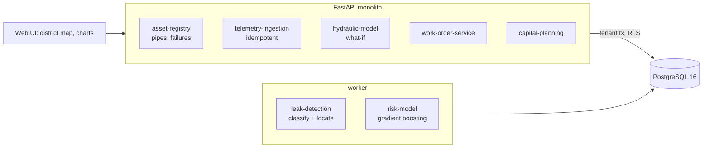

# Global Water Intelligence & Leak Prediction Platform

For a water utility: it reads pressure and flow telemetry from every district, decides whether something unusual is a leak, a
faulty sensor or just demand, works out where on the network a leak is, sends a crew to a small area instead of a whole district,
predicts which pipes will fail next, and plans five years of replacements under a fixed budget.

Built from blueprint 10 of "Advanced Project Blueprints, Volume II" as a **vertical slice**: the demo scenario end to end, with the
platform parts real and the rest listed under [Not built](#not-built-and-why).

**The utility, its pipes, failures and sensor readings come from a simulator in this repository. Hydraulics are linearised, not EPANET. The leak is located with the same model that generated the pressures, which is the best case. Costs are assumptions.**

## Run it

```bash
docker compose up --build        # migrates, seeds, serves http://localhost:8210/ui/ with one worker
docker compose run --rm test     # 29 tests against a throwaway database (about 20 s)
```

Open http://localhost:8210/ui/ and press **Run all steps** (about 10 seconds), or `make bootstrap demo`.
Demo tokens (local only): `utility-planner-demo`, `utility-analyst-demo`, `utility-viewer-demo`. Run `make reset` before a second demo run.

## The demo, step by step

1. A utility is loaded: 40 districts, 20,000 junctions, 33,572 pipes (2,014 km), 3,185 failures recorded over 2016 to 2025, 440 sensors and 591,360 readings (14 days, every 15 minutes).
2. Every district is checked. 37 are normal. Three are flagged, each with a different verdict: a leak in DMA-08, a faulty pressure sensor in DMA-22, one night of heavy demand in DMA-31. These are exactly the three things the simulator had hidden.
3. The leak is sized at 2.3 L/s (true: 1.8 L/s at the start, growing to 2.7) and placed one junction, 60 m, from where it really is. The obvious rule (the leak is at the sensor that lost the most pressure) is 600 m off. A what-if on the hydraulic model shows the predicted pressure drops beside the observed ones: 98% of the pattern explained.
4. Why the other two are not leaks: one sensor drifts 0.08 m a day while the flow meter and the other nine sensors see nothing; and a flow jump that lasted one night.
5. Work orders: an urgent acoustic survey of 52 of the district's 832 pipes (6%) for the leak, a routine recalibration for the sensor, and a refusal for the night of demand.
6. A failure model trained on 2016 to 2022 and tested on 2023 to 2025: the riskiest 5% of pipes hold 22.9% of the failures (16.7% if ranked by age alone).
7. Five years at $4M a year: 738 pipes, avoiding 2.6 times the failure cost of replacing the oldest pipes first (2.4 times when scored with the hidden true rates). The three pipes at the suspected leak go to the front.
8. The audit log.

## Architecture



| Piece | How it works |
|---|---|
| Simulator (`wa/world.py`) | Each district is a looped grid of 500 junctions fed from one inlet. Head loss is taken as proportional to flow, which makes a district one sparse linear system, solved exactly. Demand follows a daily curve with busier and quieter days; sensors have noise. Failures over ten years are drawn from a hidden rule on age, material, diameter, soil and earlier breaks. |
| Night-flow alarm | Flow between 02:00 and 04:00, when demand is lowest. A busy day lifts night flow too, so the alarm works on the constant extra flow: if nights are normally a share r of the day's average, a leak L satisfies night = r x (day - L) + L. The first five days set the normal. |
| Verdict | **Leak**: the extra flow is still there on the last two nights. **One night of demand**: it jumped and went back. **Faulty sensor**: one pressure sensor is far from its normal while inflow and the other sensors are not. Anything else that moved is "unexplained", not guessed at. |
| Locating | For each of the 500 junctions the model gives the pressure drop a leak there would cause at each of the ten sensors. The observed drops are fitted to each pattern by least squares; the junction that leaves the least unexplained wins, and its scale is a second estimate of the leak's size. |
| Hydraulic what-if | The same linear system: draw water at a junction, get the pressure drop everywhere. |
| Failure model | Gradient-boosted trees on pipe-years: age, material, diameter, soil, earlier breaks. Tested on later years than it was trained on, then refitted on all years to score the next one. It reads pipes and failures from the database, not from the simulator. |
| Capital plan | Pipes ranked by expected failure cost avoided per dollar, placed in the earliest year with budget left. Reported beside oldest-first with the same money and an upper bound no plan can beat. |
| Platform | Row-level security per utility, Postgres job queue, Idempotency-Key replay, hash-chained audit log, `/metrics`. |

## Data model

`migrations/002_water.sql` follows the blueprint (assets, sensors, telemetry, leak_events, work_orders, capital_plans); additions
are marked `(+)`: districts, asset_failures, risk_models, and the risk score on each asset. Junction numbers on the grid stand in
for PostGIS geometry. Telemetry is a plain table keyed by (sensor, time), not a time-series extension.

## API

| Method | Endpoint | Purpose |
|---|---|---|
| POST | `/v1/telemetry` | Ingest readings; a reading already stored is ignored |
| GET | `/v1/leaks` | Detected events, leaks first |
| GET | `/v1/assets/{id}/risk` | One pipe's chance of failing next year, and its rank |
| POST | `/v1/capital-plan/optimize` | Which pipes, which year, under an annual budget |
| POST | `/v1/hydraulic/simulate` | Pressure drop everywhere for water drawn at one junction |
| POST | `/v1/work-orders` | Send a crew for a leak or a sensor; refused when nothing needs fixing |
| POST | `/v1/network:load` | (+) 202 + job: load a synthetic utility |
| POST | `/v1/leaks:detect` | (+) 202 + job: check every district |
| GET | `/v1/leaks/{id}` | (+) One event with its evidence and candidate locations |
| POST | `/v1/risk:train` | (+) 202 + job: train, test and score |

Contract: [`docs/openapi.json`](docs/openapi.json).

## Measured

[`docs/evaluation.md`](docs/evaluation.md) (`python -m wa.evaluate`, three utilities the demo never uses) and [`docs/performance.md`](docs/performance.md).

| Component | Result | Baseline |
|---|---|---|
| Districts wrongly called a leak | 0 of 450 (drifting sensors, demand nights, quiet districts) | |
| Leaks found, 0.5 to 3.0 L/s | 129 of 129 | |
| Leaks found, 0.2 to 0.5 L/s | 8 of 21 | |
| Drifting sensors recognised | 122 of 150; the other 28 drifted too little and were left as normal | |
| Leak located within 3 junctions (180 m) | 83.9% | nearest sensor: 28.5% |
| Median distance from the true junction | 2 junctions | 5 junctions |
| Leak size | within 5.6% on average | |
| Failures caught in the riskiest 5% of pipes | 23.5% to 25.0% | age alone: 14.4% to 16.1% |
| Failure model AUC | 0.78 to 0.79 | age alone: 0.75 to 0.76 |
| Capital plan, failure cost avoided (hidden true rates) | $4.5M to $5.2M | oldest first: $2.2M to $2.3M; random: $0.6M to $0.7M; perfect knowledge: $5.3M to $5.5M |

Three things these numbers do not say. The localisation figures are a best case: the model that locates the leak is the model
that made the data. The failure model beats age alone only modestly, because failures are rare and mostly chance. And $20M of
replacements avoids about $5M of failure cost in five years: on these cost assumptions replacement does not pay for itself within
the plan, the plan only decides how to lose least.

## The hardest tradeoff

Catching small leaks against sending crews for nothing. Night flow in a district varies by about 3% from one day to the next
just because some days are busier, which is as much as a 0.3 L/s leak. An alarm sensitive enough to catch that leak fired on five
ordinary districts out of forty in my first version. Two changes fixed it: working on the constant extra flow rather than raw
night flow (a busy day scales the whole day, a leak adds the same at 3 am as at noon), and requiring the extra to be there on
the last two nights. The price is stated in the evaluation: leaks under 0.5 L/s are found only 38% of the time, and a real leak
is confirmed a day later than it could be. A utility that pays more for lost water than for crew time would set this the other
way, which is why both thresholds are single named constants.

## Threat model (summary)

| Threat | Mitigation here | Gap |
|---|---|---|
| A faulty sensor read as a leak, and a street dug up | Sensor faults are a separate verdict with their own work order type (no excavation); 0 of 150 drifting sensors were called leaks | Only one faulty sensor per district is recognised; two at once are "unexplained" |
| Forged or replayed telemetry | Readings are accepted only for the utility's own sensors (checked under row-level security), on the 15-minute grid, within value bounds; a resend never overwrites | No device authentication or signing: any holder of an analyst token can post readings |
| One utility seeing another's network | Row-level security on every table; tested through the API and directly in the database | |
| A crew sent on a false alarm | A work order is refused for an event classified as demand, with the reason | The verdict can still be wrong; there is no human review step before a work order |
| Acting on the model's location as fact | The API returns five candidates with fit scores and a survey area, not one point | With a real, imperfect hydraulic model the area should be wider |
| Critical infrastructure control | This system reads telemetry and writes work orders. It has no connection to valves, pumps or SCADA | |

## Not built, and why

- **A real network and a calibrated hydraulic model (EPANET / WNTR)**: head loss here is linear in flow and the model is a perfect copy of the simulated pipes. The service also rebuilds its hydraulic model from the generator's seed rather than from the stored pipes.
- **SCADA / AMI / MQTT ingestion, a time-series database, streaming**: readings arrive over HTTP into a plain table; detection runs as a batch job over a fixed 14-day window, and a district with any missing reading is skipped rather than interpolated.
- **GIS**: no PostGIS, no map tiles; a district is drawn as its grid.
- **Acoustic sensors, satellite or transient (pressure-wave) methods**: only steady pressure and inlet flow are used.
- **Leak "probability"**: the stored figure is a score from how well one junction's pattern fits, not a calibrated probability.
- **Water quality, pump energy optimisation, customer meters and billing, weather and soil-movement data**: not started.
- **Crew scheduling, street-works coordination and grouping of neighbouring pipes** in the capital plan: it is a ranked list under a budget.
- **Kafka, Redis, OpenTelemetry, Grafana, MLflow, Terraform, CI, SSO, a Next.js front end**: not needed to prove the slice; no cloud account used.

## Commercial sketch

Buyer: water utilities and their engineering consultants. Pricing shape from the blueprint: per connection or per kilometre of
network a year, with capital planning as a separate module.

## Layout

```
core/        platform kit: db + RLS, jobs, audit chain, HTTP, scenario runner, load test
wa/          world (network, hydraulics, telemetry, failures), engine (detection, localisation, risk, plan), api, seed, evaluate
migrations/  forward-only SQL          web/   UI, scenario.json, demo.json (recorded run)
tests/       29 tests                  docs/  evaluation.md, performance.md, openapi.json
```
